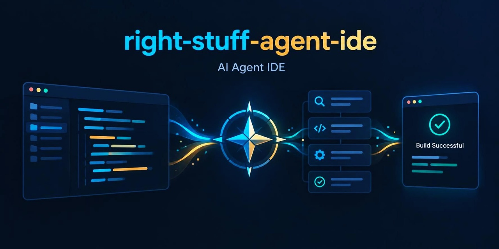
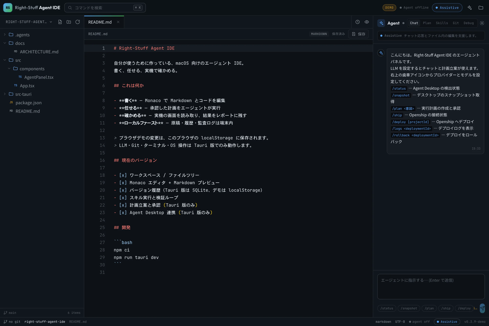
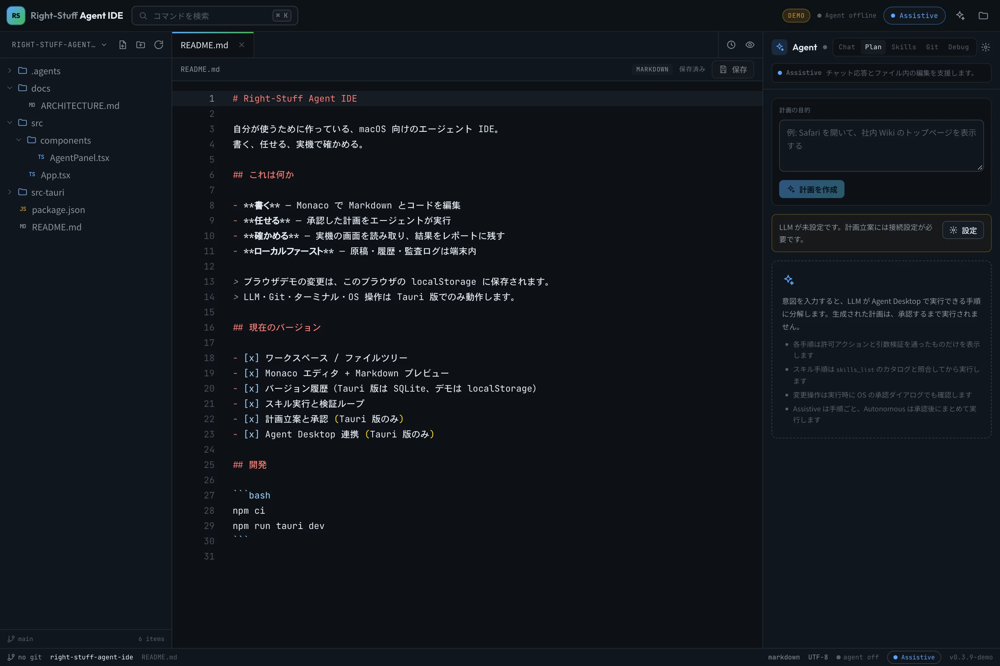

# right-stuff-agent-ide

[日本語](./README.md) | **English**

**Write, delegate, verify. An IDE where agents and your workspace share one screen.**



right-stuff-agent-ide is a macOS-only desktop IDE built to keep agents and the workspace on one screen. It is built with Tauri 2.0 and React 18, combining the writing experience of [Right-Stuff Editor](https://github.com/watanabe3tipapa/right-stuff-editor-desktop) with the OS-level control of [Agent Desktop](https://github.com/vercel-labs/agent-desktop).

> **Hobby project (Early Access)** — a personal app, not a commercial product. No commercial support or SLA.
>
> **Files stay local. Actions stay visible.** Drafts remain in the folder you choose, and every command an agent runs is shown with its output in the UI. No accounts, telemetry, or cloud sync.

[](LICENSE)
[](https://github.com/watanabe3tipapa/right-stuff-agent-ide/actions/workflows/ci.yml)
[](https://github.com/watanabe3tipapa/right-stuff-agent-ide/releases/latest)
[](https://github.com/watanabe3tipapa/right-stuff-agent-ide)
[](https://github.com/watanabe3tipapa/right-stuff-agent-ide)

**Links:** [Live site](https://right-stuff-agent-ide.vercel.app/) · [Browser demo](https://right-stuff-agent-ide.vercel.app/app/) · [Releases](https://github.com/watanabe3tipapa/right-stuff-agent-ide/releases) · [Issues](https://github.com/watanabe3tipapa/right-stuff-agent-ide/issues)

## What this is

A single app for the workspace, a Monaco editor, version history, LLM chat, planning, skill execution, Git, an integrated terminal, LSP, and DAP. The core loop is **write → delegate → verify**.

| Experience | What it provides |
|---|---|
| Write | Monaco-based Markdown and code editing, tabs, dirty tracking, GFM preview |
| Delegate | LLM chat, plan generation, skill execution (editor / Git / terminal / debug) |
| Verify | Verification loop (typecheck / lint / test), auto-fix, Japanese text checks, HTML reports |
| Keep | Direct saves into the workspace, version history in SQLite |
| Protect | Atomic writes, path validation, trash-based soft delete, native approval, audit log |
| Connect | Agent Desktop CLI detection, snapshots, allowlisted actions |
| Extend | Quick Open, Git panel, integrated terminal (PTY), LSP, DAP debugging |

IDE features (LSP, DAP, Git, integrated terminal) are already included. Agent integration stays at the center, and the IDE experience will keep improving in future releases.

**Who it is for**

- People who want an LLM to draft, revise, and verify, but want to inspect every action
- People who prefer to keep drafts and code in local folders instead of a cloud service
- macOS users who want fewer switches between the editor and the agent

**Who it is not for**

- Replacing every feature of VS Code or Cursor
- Team collaboration or cloud sync
- Windows or Linux

## What this is not

- **Not a VS Code / Cursor replacement.** IDE features (LSP, DAP, Git, terminal) are included but will keep improving in future releases
- **Not a cloud IDE.** There are no accounts, telemetry, or cloud sync
- **Not an unattended agent that runs anything.** Mutating actions pass through policy and native approval
- **No Windows or Linux build.** The app depends on macOS Accessibility APIs and window control

## Screenshots

| Editor | Plan and approval |
|---|---|
|  |  |

## Download

Get a DMG from [GitHub Releases](https://github.com/watanabe3tipapa/right-stuff-agent-ide/releases/latest).

- Apple Silicon (arm64): `Right-Stuff.Agent.IDE_<version>_aarch64.dmg`
- Intel (x86_64): `Right-Stuff.Agent.IDE_<version>_x64.dmg`

Supports **macOS 11 or later (Apple Silicon and Intel)**.

> The DMGs are not signed with an Apple Developer ID and are not notarized (arm64 is ad-hoc signed; x64 is unsigned). If macOS warns on first launch, right-click the app and choose "Open". Running the x64 build on Apple Silicon requires Rosetta 2.
>
> The x64 build (v0.4.1) was launched from its DMG on an Intel Core i7 Mac running macOS 15.8.4.

## Three-minute quick start

1. Open the DMG, copy `Right-Stuff Agent IDE.app` to Applications, and launch it
2. Choose a workspace from the folder name in the sidebar
3. Open a file from the tree, edit it, and press `⌘S` to save
4. Open Settings when you need more
   - **Apple FM**: the default LLM on Apple Silicon. Detect, start, and stop `fm serve`, then apply it to the LLM from Settings > Apple FM (see below)
   - **LLM**: Base URL, model, and API key for an OpenAI-compatible API (fallback when OpenCode is not connected)
   - **OpenCode**: install `opencode` (1.2.0 or newer) separately and add it to `PATH`, or set the binary under Settings > OpenCode, for natural-language deployment. Start a session in the Agent panel's OpenCode tab and pick the model to use. OpenCode tools such as file edits, shell commands, and web fetching are allowed by default
   - **Agent Desktop**: the `agent-desktop` CLI (not bundled)
   - **LSP / DAP**: language servers and debug adapters for your languages (not bundled)

To try the UI without installing, open the [browser demo](https://right-stuff-agent-ide.vercel.app/app/).

### Using Apple FM (Apple Silicon / macOS 27 or later)

On Apple Silicon, Apple Foundation Models can be the default LLM. The app can start the OpenAI-compatible `fm serve` for you, so no API key is required and your input never leaves the device.

1. Enable Apple Intelligence in System Settings
2. Once, run `sudo fm license` in Terminal and accept the license
3. Open Settings > **Apple FM**, choose **Start server**, then **Apply and test connection**
4. Select the on-device `system` model (`pcc` is only available where Private Cloud Compute is usable)

To start it manually:

```sh
fm serve --host 127.0.0.1 --port 1976
```

The base URL is `http://127.0.0.1:1976/v1` and the model is `system`. On Intel Macs or macOS 26 and earlier, `fm` is not available; choose OpenAI, Ollama, LM Studio, or another provider under Settings > LLM.

## Highlights

- **Write** — Monaco editor, tabs, dirty tracking, GFM preview, `⌘P` Quick Open, `⌘K` command palette
- **Keep** — direct saves into the workspace, with up to the latest 100 versions per file in SQLite
- **Delegate** — natural-language deployment through OpenCode (ACP), OpenAI-compatible LLM chat (fallback), plan generation, skill execution (editor / Git / terminal / debug)
- **Verify** — typecheck / lint / test verification loop, auto-fix for failures, Japanese text checks, self-contained HTML reports
- **Connect** — Agent Desktop CLI detection, snapshots, allowlisted actions
- **IDE** — Git panel, integrated terminal (PTY), LSP, DAP; expanding in future releases
- **Protect** — atomic writes, path validation, trash-based deletes, agent policy, native approval, audit log
- **Try** — browser demo and PWA, no install required

See [docs/FEATURES.md](./docs/FEATURES.md) for details (Japanese).

## Safety and privacy

- Drafts are stored as workspace files and are never uploaded automatically
- No accounts, telemetry, or cloud sync
- File operations are validated in Rust; absolute paths, `..`, and writes outside the workspace are rejected
- Agent Desktop and skill runs pass through an allowlist, the agent policy, and native approval
- API keys and the Openship PAT are stored only in the OS keychain and never in SQLite, logs, or error messages
- The audit log is stored only in local SQLite. It contains command arguments, output excerpts, and errors, so take care when sharing it
- Snapshots always show a native confirmation before capture and stay in memory only. Automatic masking of sensitive windows is not implemented yet

### External connections

Editing, saving, history, Git, the terminal, and LSP / DAP work without external connections. Traffic leaves the machine only through the paths you configure.

| Path | Sent | Not sent |
|---|---|---|
| LLM chat | Chat messages, planning intent, and the changed files plus failure output selected for auto-fix | The whole workspace, snapshots, the audit log, settings other than credentials |
| OpenCode | Prompts and workspace files (over ACP). Authentication is handled by OpenCode's own store | The Openship PAT (held only by the IDE MCP server), the audit log |
| Openship | Deployment metadata and operation requests | The PAT in plaintext (read from the keychain in Rust), drafts |

The scope of external connections, visibility into what is sent, and masking of sensitive data are under review. Share concerns in [Issues](https://github.com/watanabe3tipapa/right-stuff-agent-ide/issues). Details are in [SECURITY.md](./SECURITY.md) and [docs/SECURITY.md](./docs/SECURITY.md) (Japanese).

## Why macOS only

Agent Desktop relies on macOS Accessibility APIs and window control. The keychain, Trash, and the overlay title bar are also native macOS features. Tauri itself is cross-platform, but this app focuses on the macOS experience.

## What is Openship, and why use it?

[Openship](https://openship.io/) is an open-source, self-hostable deployment platform with a CLI and a REST API. The app uses it for deployment history, logs, and rollbacks.

It was chosen because it can be self-hosted without a mandatory external account, offers both a CLI and a REST API, fits deploy / history / logs / rollback into one panel, and can roll back through its API. The comparison with GitHub Actions, rsync / SSH, Docker / Kubernetes, and SaaS deployment platforms is documented in [docs/OPENSHIP.md](./docs/OPENSHIP.md) (Japanese).

- The `openship` CLI is preferred when detected; the REST API is used only as a fallback
- Connection settings live in SQLite, the PAT lives in the OS keychain, and all requests are made from Rust
- Deploy and rollback are disabled in Passive mode and always require native approval in other modes
- OpenCode can request these actions only through the IDE MCP server; the PAT is never passed to OpenCode

See the [architecture diagram](./docs/diagrams/openship-local-first.html).

## Known limitations

- macOS only; no Windows or Linux builds
- The `agent-desktop` CLI, `opencode`, language servers, and debug adapters are not bundled
- OpenCode integration requires `opencode` 1.2.0 or newer; the IDE does not ship it
- LLM support covers OpenAI-compatible APIs only (Anthropic-specific APIs are not supported)
- Git uses the local `git` CLI; merge, rebase, and push are not implemented
- DAP supports `lldb-dap` and `debugpy` only; attach and conditional breakpoints are not implemented
- The verification loop targets workspaces with `package.json` or `Cargo.toml` and runs a fixed set of commands
- The browser demo cannot use LLM, Git, the terminal, or OS control
- No auto-update

See [docs/LIMITATIONS.md](./docs/LIMITATIONS.md) for details (Japanese).

## Roadmap

- Strengthen IDE features (LSP, DAP, Git, integrated terminal)
- Make external connections visible and controllable (inspect what is sent, mask sensitive data)
- Developer ID signing and notarization
- Auto-update

## Development

```bash
git clone https://github.com/watanabe3tipapa/right-stuff-agent-ide.git
cd right-stuff-agent-ide
npm ci
npm run tauri dev
```

| Command | Purpose |
|---|---|
| `npm run tauri dev` | Native development window (HMR) |
| `npm run dev` | Browser demo |
| `npm run build` | Type-check and build the frontend |
| `npm test` | Vitest |
| `npm run lint` | ESLint |
| `npm run glossary` | Japanese terminology check |
| `npm run tauri build` | Build the `.app` / `.dmg` |

Requires macOS 11 or later, Node.js `^20.19.0 || >=22.12.0`, Rust 1.88 or later, and Xcode Command Line Tools. Build steps, LSP / DAP setup, PWA, and release steps are in [docs/DEVELOPMENT.md](./docs/DEVELOPMENT.md) (Japanese).

## Documentation

- [docs/FEATURES.md](./docs/FEATURES.md) — feature details (JA)
- [docs/LIMITATIONS.md](./docs/LIMITATIONS.md) — known limitations (JA)
- [docs/OPENSHIP.md](./docs/OPENSHIP.md) — why Openship and how the integration works (JA)
- [docs/DEVELOPMENT.md](./docs/DEVELOPMENT.md) — build, tools, releases (JA)
- [docs/ARCHITECTURE.md](./docs/ARCHITECTURE.md) — layers, process model, save flow (JA)
- [docs/SKILLS.md](./docs/SKILLS.md) — skill manifests, policy, approval, verification (JA)
- [docs/API.md](./docs/API.md) — Tauri commands and types (JA)
- [SECURITY.md](./SECURITY.md) — vulnerability reporting and supported versions (JA)
- [docs/SECURITY.md](./docs/SECURITY.md) — path validation, agent permissions, stored data (JA)
- [docs/GLOSSARY.md](./docs/GLOSSARY.md) — Japanese terminology (JA)
- [DEV-MEMO.md](./DEV-MEMO.md) — release history and design notes (JA)
- [Implementation plan](./right-stuff-agent-ide-implementation-plan.html) — overall design and roadmap (JA)

## License

MIT License — see [LICENSE](LICENSE).

RIGHT-STUFF AGENT IDE is a personal project. Tauri, React, Monaco Editor, and Agent Desktop remain under their respective licenses.
