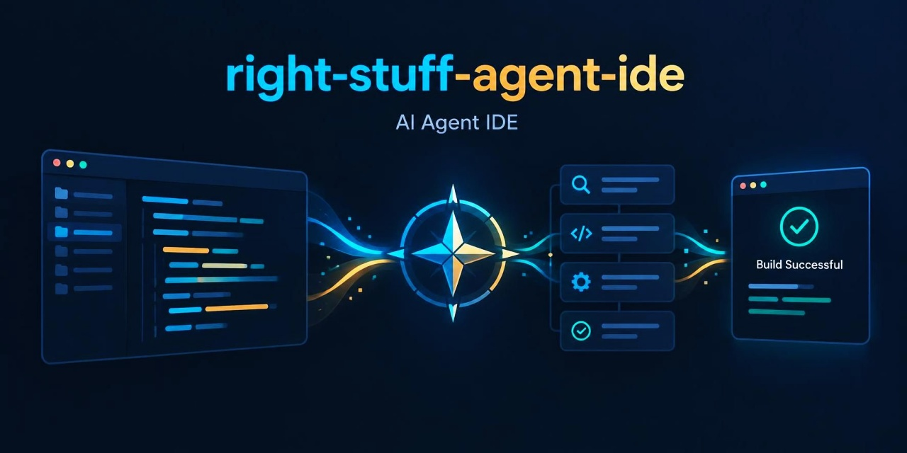
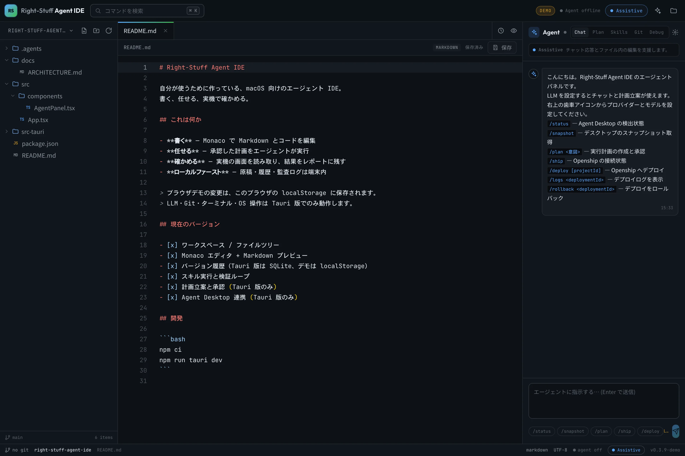
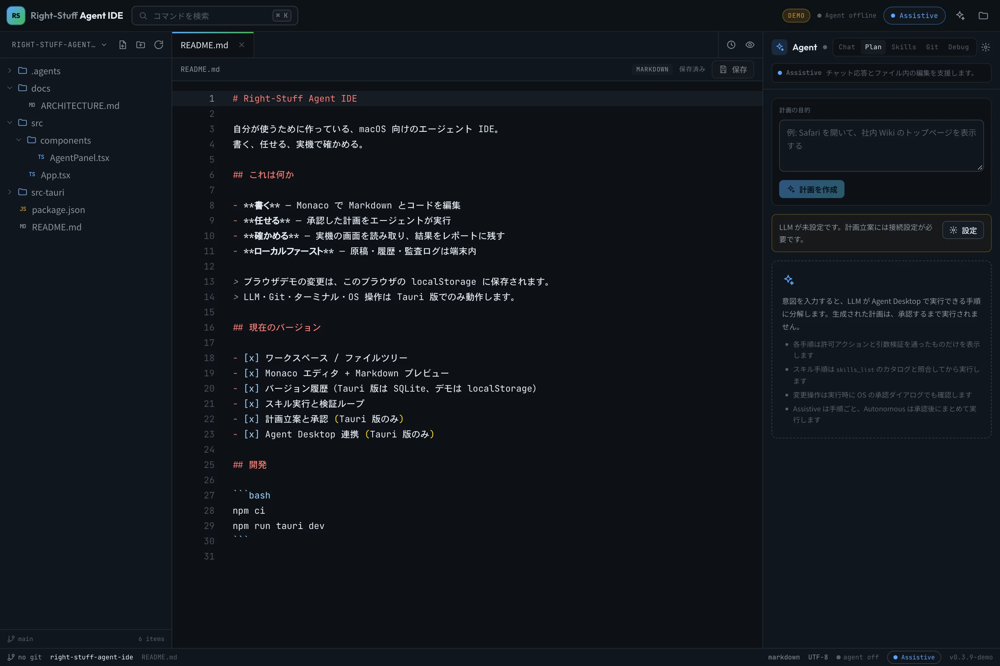

# right-stuff-agent-ide

**日本語** | [English](./README.en.md)

**書く、任せる、確かめる。エージェントとワークスペースを、ひとつの画面へ。**



right-stuff-agent-ide は、エージェントとワークスペースを同じ画面に置く macOS 専用のデスクトップ IDE です。Tauri 2.0 + React 18 で構築し、[Right-Stuff Editor](https://github.com/watanabe3tipapa/right-stuff-editor-desktop) の執筆体験と [Agent Desktop](https://github.com/vercel-labs/agent-desktop) の OS レベル操作を統合しています。

> **Hobby project（Early Access）** — 個人が自分用に作っているアプリです。商用サポートや SLA はありません。
>
> **ファイルは手元に、操作は見える形で。** 原稿は選んだフォルダのファイルに残り、エージェントが実行したコマンドと結果は UI に表示されます。アカウント登録、テレメトリ、クラウド同期はありません。

[](LICENSE)
[](https://github.com/watanabe3tipapa/right-stuff-agent-ide/actions/workflows/ci.yml)
[](https://github.com/watanabe3tipapa/right-stuff-agent-ide/releases/latest)
[](https://github.com/watanabe3tipapa/right-stuff-agent-ide)
[](https://github.com/watanabe3tipapa/right-stuff-agent-ide)

**リンク:** [公開サイト](https://right-stuff-agent-ide.vercel.app/) · [ブラウザデモ](https://right-stuff-agent-ide.vercel.app/app/) · [Releases](https://github.com/watanabe3tipapa/right-stuff-agent-ide/releases) · [Issues](https://github.com/watanabe3tipapa/right-stuff-agent-ide/issues)

## これは何か

ワークスペース、Monaco エディタ、バージョン履歴、LLM チャット、計画立案、スキル実行、Git、統合ターミナル、LSP、DAP を 1 つのアプリにまとめました。中心にあるのは **書く → 任せる → 確かめる** のループです。

| 体験 | 対応する機能 |
|---|---|
| 書く | Monaco による Markdown / コード編集、タブ、未保存管理、GFM プレビュー |
| 任せる | LLM チャット、計画立案、スキル実行（エディタ / Git / ターミナル / デバッグ） |
| 確かめる | 検証ループ（typecheck / lint / test）、検証の自動修正、日本語表記チェック、HTML レポート |
| 残す | ワークスペースへ直接保存、SQLite にバージョン履歴 |
| 守る | atomic write、パス検証、ゴミ箱へのソフトデリート、ネイティブ承認、監査ログ |
| つなぐ | Agent Desktop CLI の検出、スナップショット、許可アクションの実行 |
| 広げる | クイックオープン、Git パネル、統合ターミナル (PTY)、LSP、DAP デバッグ |

IDE 機能（LSP / DAP / Git / 統合ターミナル）は搭載済みです。エージェント連携を中心に据えつつ、IDE としての完成度は今後のバージョンで高めていきます。

**向いている人**

- LLM に下書き・修正・検証を任せたいが、実行内容は自分で確認したい
- 原稿やコードをクラウドに預けず、手元のフォルダのまま扱いたい
- macOS で、エディタとエージェントの行き来を減らしたい

**向いていない人**

- VS Code / Cursor の全機能を置き換えたい
- チームでの共同編集やクラウド同期が必要
- Windows / Linux で使いたい

## これは何ではないか

- **VS Code / Cursor の代替ではありません。** IDE 機能（LSP / DAP / Git / ターミナル）は搭載済みですが、今後も継続的に高めていく段階です
- **クラウド IDE ではありません。** アカウント、テレメトリ、クラウド同期はありません
- **無人で何でも実行するエージェントではありません。** 変更操作はポリシーとネイティブ承認を通ります
- **Windows / Linux 版はありません。** macOS の Accessibility API とウィンドウ操作に依存しています

## スクリーンショット

| エディタ | 計画と承認 |
|---|---|
|  |  |

## ダウンロード

[GitHub Releases](https://github.com/watanabe3tipapa/right-stuff-agent-ide/releases/latest) から DMG を取得してください。

- Apple Silicon (arm64): `Right-Stuff.Agent.IDE_<version>_aarch64.dmg`
- Intel (x86_64): `Right-Stuff.Agent.IDE_<version>_x64.dmg`

対応 OS は **macOS 11 以降（Apple Silicon / Intel）** です。

> DMG は Apple Developer ID 署名・公証を受けていません（arm64 は ad-hoc 署名、x64 は未署名）。初回起動時に警告が出た場合は、アプリを右クリック →「開く」を選択してください。Apple Silicon で x64 版を使う場合は Rosetta 2 が必要です。
>
> x64 版（v0.4.1）は、Intel Core i7 / macOS 15.8.4 の実機で DMG からの起動を確認済みです。

## 3 分クイックスタート

1. DMG を開き、`Right-Stuff Agent IDE.app` を Applications へコピーして起動します
2. サイドバーのフォルダ名からワークスペースを選びます
3. ツリーからファイルを開いて編集し、`⌘S` で保存します
4. 必要に応じて設定を開きます
   - **LLM**: OpenAI 互換 API の Base URL・モデル・API キー
   - **Agent Desktop**: `agent-desktop` CLI（未同梱）
   - **LSP / DAP**: 使う言語の言語サーバー / デバッグアダプター（未同梱）

インストールせずに UI だけ試す場合は [ブラウザデモ](https://right-stuff-agent-ide.vercel.app/app/) を開いてください。

## 主な機能

- **書く** — Monaco エディタ、タブ、未保存管理、GFM プレビュー、`⌘P` クイックオープン、`⌘K` コマンドパレット
- **残す** — ワークスペースへ直接保存。保存ごとに SQLite へ履歴を記録し、ファイルあたり最新 100 版を保持
- **任せる** — OpenAI 互換 API の LLM チャット、計画立案、スキル実行（エディタ / Git / ターミナル / デバッグ）
- **確かめる** — typecheck / lint / test の検証ループ、失敗時の自動修正、日本語表記チェック、自己完結 HTML レポート
- **つなぐ** — Agent Desktop CLI の検出、スナップショット、許可アクションの実行
- **IDE** — Git パネル、統合ターミナル (PTY)、LSP、DAP。今後のバージョンで拡張
- **守る** — atomic write、パス検証、ゴミ箱への削除、エージェントポリシー、ネイティブ承認、監査ログ
- **試す** — ブラウザデモと PWA（インストール不要）

機能の詳細は [docs/FEATURES.md](./docs/FEATURES.md) を参照してください。

## 安全性とプライバシー

- 原稿はワークスペースのファイルとして保存され、自動で外部へ送信されません
- アカウント登録、テレメトリ、クラウド同期はありません
- ファイル操作は Rust 側で検証し、絶対パス、`..`、ワークスペース外への書き込みを拒否します
- Agent Desktop とスキルの実行は、許可リスト、エージェントポリシー、ネイティブ承認を通します
- API キーと Openship の PAT は OS キーチェーンにのみ保存し、SQLite・ログ・エラーメッセージには含めません
- 監査ログはローカルの SQLite にのみ保存します。コマンド引数・出力・エラーの抜粋を含むため、共有する場合は注意してください
- スナップショットは取得前に毎回ネイティブ確認を表示し、内容はメモリ上にのみ保持します。機密ウィンドウの自動マスクは未実装です

### 外部接続

編集・保存・履歴・Git・ターミナル・LSP / DAP は外部接続なしで動作します。外部へ出るのは、ユーザーが設定した次の経路だけです。

| 経路 | 送るもの | 送らないもの |
|---|---|---|
| LLM チャット | チャットの会話、計画立案の意図、自動修正で選んだ変更ファイルと失敗出力 | ワークスペース全体、スナップショット、監査ログ、API キー以外の設定 |
| Openship | デプロイ対象のメタデータと操作指示 | PAT の平文（キーチェーンから Rust 側で読み出す）、原稿 |

外部接続の範囲、送信内容の可視化、機密情報のマスクは現在も見直しを進めています。懸念点は [Issues](https://github.com/watanabe3tipapa/right-stuff-agent-ide/issues) で共有してください。詳細は [SECURITY.md](./SECURITY.md) と [docs/SECURITY.md](./docs/SECURITY.md) にまとめています。

## macOS 専用の理由

Agent Desktop は macOS の Accessibility API とウィンドウ操作を使います。キーチェーン、ゴミ箱、Overlay タイトルバーも macOS ネイティブの機能です。Tauri 自体はクロスプラットフォームですが、このアプリは macOS の体験に絞っています。

## Openship とは、なぜ採用したか

[Openship](https://openship.io/) は、オープンソースでセルフホストできるデプロイ基盤です。CLI と REST API を持ち、アプリからデプロイ履歴・ログ・ロールバックを操作できます。

採用した理由は、セルフホストできて外部アカウントを必須にしないこと、CLI と REST の両方があること、デプロイ・履歴・ログ・ロールバックを 1 つの画面に収められること、そしてロールバックを API で扱えることです。GitHub Actions、rsync / SSH、Docker / Kubernetes、SaaS 型のデプロイ基盤と比較した判断は [docs/OPENSHIP.md](./docs/OPENSHIP.md) にまとめています。

- `openship` CLI があれば CLI を優先し、未検出のときだけ REST API にフォールバックします
- 接続設定は SQLite、PAT は OS キーチェーンに保存し、通信は Rust 側で行います
- デプロイとロールバックは Passive モードでは無効で、それ以外のモードでもネイティブ承認が必要です

構成図は [docs/diagrams/openship-local-first.html](./docs/diagrams/openship-local-first.html) を参照してください。

## 既知の制約

- macOS 専用で、Windows / Linux 版はありません
- `agent-desktop` CLI、言語サーバー、デバッグアダプターは同梱していません
- LLM は OpenAI 互換 API のみです（Anthropic 固有 API は未対応）
- Git はローカルの `git` CLI を使い、マージ・リベース・プッシュは未対応です
- DAP は `lldb-dap` と `debugpy` のみで、attach と条件付きブレークポイントは未対応です
- 検証ループは `package.json` / `Cargo.toml` を持つワークスペースだけで、固定コマンドのみ実行します
- ブラウザデモでは LLM・Git・ターミナル・OS 操作は動きません
- 自動更新はありません

制約の詳細は [docs/LIMITATIONS.md](./docs/LIMITATIONS.md) を参照してください。

## ロードマップ

- IDE 機能の強化（LSP / DAP / Git / 統合ターミナル）
- 外部接続の可視化と制御（送信内容の確認、機密情報のマスク）
- Developer ID 署名・公証
- 自動更新

## 開発

```bash
git clone https://github.com/watanabe3tipapa/right-stuff-agent-ide.git
cd right-stuff-agent-ide
npm ci
npm run tauri dev
```

| コマンド | 用途 |
|---|---|
| `npm run tauri dev` | ネイティブウィンドウで開発起動（HMR） |
| `npm run dev` | ブラウザデモ |
| `npm run build` | 型検査 + フロントエンドビルド |
| `npm test` | Vitest |
| `npm run lint` | ESLint |
| `npm run glossary` | 日本語表記チェック |
| `npm run tauri build` | `.app` / `.dmg` をビルド |

前提は macOS 11 以降、Node.js `^20.19.0 || >=22.12.0`、Rust 1.88 以降、Xcode Command Line Tools です。ビルド手順、LSP / DAP の導入、PWA、リリース手順は [docs/DEVELOPMENT.md](./docs/DEVELOPMENT.md) を参照してください。

## ドキュメント

- [docs/FEATURES.md](./docs/FEATURES.md) — 機能詳細
- [docs/LIMITATIONS.md](./docs/LIMITATIONS.md) — 既知の制約
- [docs/OPENSHIP.md](./docs/OPENSHIP.md) — Openship 連携の採用理由と仕組み
- [docs/DEVELOPMENT.md](./docs/DEVELOPMENT.md) — ビルド、ツール導入、リリース
- [docs/ARCHITECTURE.md](./docs/ARCHITECTURE.md) — レイヤー、プロセスモデル、保存フロー
- [docs/SKILLS.md](./docs/SKILLS.md) — スキルマニフェスト、実行ポリシー、承認、検証ループ
- [docs/API.md](./docs/API.md) — Tauri コマンドと型
- [SECURITY.md](./SECURITY.md) — 脆弱性報告とサポート対象
- [docs/SECURITY.md](./docs/SECURITY.md) — パス検証、エージェント権限、保存データ
- [docs/GLOSSARY.md](./docs/GLOSSARY.md) — 日本語表記の用語集
- [DEV-MEMO.md](./DEV-MEMO.md) — リリース履歴と設計メモ
- [実装設計書](./right-stuff-agent-ide-implementation-plan.html) — 全体設計とロードマップ

## ライセンス

MIT ライセンス — 詳細は [LICENSE](LICENSE) を参照してください。

RIGHT-STUFF AGENT IDE は個人プロジェクトです。Tauri、React、Monaco Editor、Agent Desktop はそれぞれのライセンスに従います。
