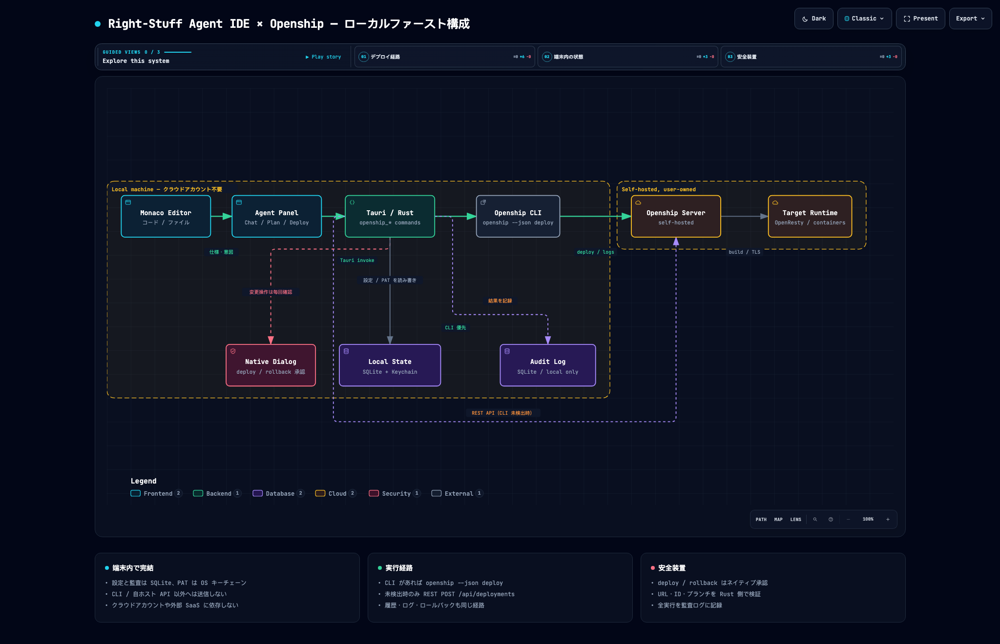

# Architecture

## 対象プラットフォーム

デスクトップアプリは macOS 11 以降（Apple Silicon / Intel）専用です。Windows / Linux 向けのビルドは提供しません。ブラウザデモとランディングページは OS を問わず動作します。

## レイヤー

```
┌──────────────────────────────────────────────────────────┐
│ Presentation (React 18 + Vite + TypeScript)              │
│  FileTree / EditorPane (Monaco) / AgentPanel / StatusBar │
├──────────────────────────────────────────────────────────┤
│ Frontend Bridge (src/lib/api.ts)                         │
│  Tauri invoke ラッパー + ブラウザ用デモフォールバック        │
├──────────────────────────────────────────────────────────┤
│ Tauri Commands (src-tauri/src/commands)                  │
│  workspace / editor / agent / settings / app             │
├──────────────────────────────────────────────────────────┤
│ Core Engine                                              │
│  paths (検証) / db (SQLite WAL) / atomic write            │
├──────────────────────────────────────────────────────────┤
│ OS Integration                                           │
│  Agent Desktop CLI (snapshot / action / verify)          │
└──────────────────────────────────────────────────────────┘
```

## プロセスモデル

- WebView が UI を描画し、`invoke` で Rust 側のコマンドを呼び出す。
- ファイル I/O と SQLite は Rust プロセス内で完結する。
- Agent Desktop は Rust から子プロセスとして起動する。stdout / stderr はそのまま UI に返す。
- Git は Rust から `git` CLI を子プロセスとして起動する。シェルを介さず、引数を配列で渡す。
- 統合ターミナルは Rust 内で PTY を確保し、読み取り専用スレッドが出力を `terminal://output` イベントで WebView へ流す。
- ブラウザで `npm run dev` した場合、`src/lib/demo.ts` の仮想ワークスペースに切り替わる。

## フロントエンドの読み込み

起動時の JavaScript を小さく保つため、次のコンポーネントは `React.lazy` + `Suspense` で遅延読み込みする。

- `EditorPane`（Monaco Editor）
- `TerminalDock`（xterm.js。ターミナルを開いたときのみ）
- `MarkdownPreview`（react-markdown / remark-gfm。プレビュー表示時のみ）
- `SettingsDialog` / `HistoryDialog` / `CommandPalette` / `QuickOpen`

Monaco の worker（editor / json / css / html / typescript）は Vite の `?worker` import で個別アセットになり、編集中の言語に応じて読み込まれる。これにより初期バンドルは数百 kB 程度に収まり、数 MB の Monaco 本体と言語 worker は必要になるまで転送されない。

## 状態

| 場所 | 内容 |
| --- | --- |
| `AppState.root` | 現在のワークスペース (canonical path) |
| `AppState.db` | SQLite 接続 (履歴・設定) |
| `AppState.terminals` | 起動中の PTY セッション (writer / master / child) |
| `workspaceStore` | ツリー、選択、展開状態 |
| `editorStore` | 開いているタブ、未保存内容、履歴モーダル |
| `agentStore` | モード、Agent Desktop の検出状態、チャット、計画と実行状態 |
| `gitStore` | Git の状態、差分、ログ、実行中フラグ |

`localStorage` に保存するのはエージェントモードのみ。それ以外の永続データは
SQLite (`right-stuff.db`) とワークスペース内のファイルに置く。

## 保存フロー

```
編集 (Monaco onChange)
  → editorStore.updateContent (dirty = content !== savedContent)
  → ⌘S / 保存ボタン
  → workspace_write_file
      → resolve_new (ワークスペース外を拒否)
      → 一時ファイルへ書き込み → rename (atomic write)
      → db::record_version (最新 100 版を保持)
  → savedContent を更新して dirty を解除
```

保存中にユーザーが編集を続けた場合、書き込んだ内容と現在の内容が一致するまで
dirty を維持する（保存済みと誤判定して未保存の入力を失わない）。

ワークスペース切替と「すべてのタブを閉じる」は `confirmUnsavedChanges` を通す。
未保存のタブがある場合は「保存して続行」「保存せず続行」「キャンセル」を提示し、
キャンセルまたは保存失敗時は破壊的な操作を実行しない。

## 終了時の未保存確認

```
ウィンドウを閉じる (onCloseRequested)
  → event.preventDefault()
  → confirmUnsavedChanges (保存 / 破棄 / キャンセル)
  → 許可された場合のみ app_quit → app.exit(0)

⌘Q / アプリメニューの「終了」
  → Rust がメニュー項目 app:quit を WebView へ通知
  → 同じ confirmUnsavedChanges
  → 許可された場合のみ app_quit
```

macOS では `RunEvent::ExitRequested` が `⌘Q` で発火しないため、既定メニューの
Quit 項目を `app:quit` に置き換えて `app://quit-requested` を送る。Dock メニューの
「終了」やログアウトは OS が直接終了するため対象外。

## LLM チャットフロー

```
ユーザー入力
  → agentStore.send
  → toRequestMessages (直近 20 件、ローカル通知とコマンド出力を除外)
  → api.llmChat (Tauri Channel)
  → Rust: llm_chat
      → 設定と API キーを読み込み (キーは OS キーチェーン)
      → POST {baseUrl}/chat/completions (stream: true)
      → SSE を解析して delta / done / cancelled / error を Channel へ送信
  → agentStore が応答を逐次更新
  → llm_cancel で協調的キャンセル
```

API キーは Rust プロセス内でのみ扱い、WebView・SQLite・ログ・エラー文字列へは渡さない。
CSP の `connect-src` に外部オリジンを追加しないため、LLM への HTTP 通信は必ず Rust 側で行う。

## 計画立案と承認フロー

```
ユーザー意図 (/plan or Plan タブ)
  → buildPlanMessages (許可アクションと JSON スキーマをシステムプロンプトに含める)
  → api.llmChat (既存のストリーミング経路)
  → parsePlan
      → JSON 抽出 (コードフェンス許容)
      → 許可アクション・引数個数・長さ・NUL・アプリ名の検証
      → 読み取り / 変更リスクをアクションから決定
  → agentStore.plan (draft) + 監査ログ plan_created
  → ユーザーが計画を承認 / 却下 (監査ログ plan_approved / plan_rejected / plan_cancelled)
      → Assistive: 承認済みの手順を 1 つずつ実行
      → Autonomous: 承認済みの手順を順に実行し、失敗で停止
  → agent_run (Rust 側で再検証 + ポリシー判定 + 必要ならネイティブ承認)
  → 手順ごとに stdout / stderr / 終了コードを保存し、監査ログ action_*
```

モデルが返した計画は信頼しない。`src/lib/plan.ts` が Rust の `agent_run` と
同じ許可リスト・引数規則で事前検証し、不正な手順を含む計画は表示しない。
計画の承認は実行可否を決める UI 上の状態であり、Rust の検証とネイティブ承認を
置き換えない。計画と実行結果はメモリ上にのみ保持する。

## ポリシーと監査ログ

```
設定 > エージェント
  → AgentPolicySettings が draft を編集
  → agent_policy_set (Rust で正規化・検証)
  → SQLite settings に agent_policy として保存
  → 監査ログ policy_updated を記録

agent_run / agent_snapshot
  → SQLite からポリシーを読み直す
      allow: そのまま実行
      ask:   ネイティブ承認ダイアログ
      block: CLI を起動せずエラー
  → audit_log に action_run / action_blocked / action_cancelled を記録

Audit タブ
  → audit_log_list (新しい順、50 件ずつ)
  → 保持期間・件数上限を超えた記録は次の記録時に削除
```

ポリシーは読み取り専用アクションだけ `allow` を選べる。変更アクションは
`ask` / `block` のみで、ネイティブ承認を省略できない。監査ログは計画の
作成・承認・却下・中止、操作の実行・拒否・キャンセル、ポリシー変更を
ローカルの SQLite に保存し、外部へ送信しない。

## エージェント操作フロー

```
ユーザー意図
  → 計画立案 (実装済み: Agent Desktop の許可アクションのみ)
  → 計画単位の承認 (実装済み)
  → agent_run (許可リスト + 引数検証 + 変更操作の承認)
  → Agent Desktop が OS を操作
  → agent_snapshot で状態を再取得
  → 結果を検証して UI に返す (検証ループは今後)
```

`agent_status` / `agent_snapshot` / `agent_run` のブリッジ、引数検証、
エージェントポリシー、ネイティブ承認ダイアログ、UI からの `/status`・`/snapshot` 実行、
OpenAI 互換 API のチャット（ストリーミング・停止・接続テスト）、
計画の生成・承認・実行、監査ログまでを実装している。スキル実行は
`code-edit` の `editor.*` ハンドラ、ポリシー、承認、監査まで実装済みで、
検証ループとフロントエンド UI は未実装。

### スキル実行と検証ループ（一部実装済み）

v0.4.0 では、エディタ・Git・ターミナルの操作を宣言するスキルマニフェストと、
`allow` / `ask` / `block` の実行ポリシーを追加する。マニフェストはリポジトリ内の
宣言に限定し、実行は Rust の閉じたハンドラだけが行う。v0.4.0 の最小垂直スライスは
`code-edit`（読み取り・一意一致の文字列置換・作成）で、実行・承認・監査までを
実装済み。検証ループ（typecheck / lint / test）は v0.5 で追加する。

スキーマ、承認フロー、パス・コマンドの制限、監査項目、API、テスト計画は
[SKILLS.md](./SKILLS.md) を参照。機械可読スキーマは
[skills.schema.json](./skills.schema.json)。

## Openship 連携（ローカルファースト）



インタラクティブ版: [diagrams/openship-local-first.html](diagrams/openship-local-first.html)

```
Agent Panel (Deploy タブ / /deploy / /logs / /rollback)
  → api.openship_* (Tauri invoke)
  → Rust: 設定・ID・URL を正規化して検証
  → CLI を検出できれば openship --json deploy
      → 失敗または未検出なら REST POST /api/deployments
  → deploy / rollback は必ずネイティブ承認ダイアログ
  → 結果と実行コマンドを監査ログへ記録
  → デプロイ履歴・ログは Rust 経由で取得し UI に表示
```

- 接続設定は SQLite の `openship_config`、PAT は OS キーチェーン
  (`com.rightstuff.agentide.openship`) に保存する。WebView へトークンを返さない。
- CLI は設定されたパス、`PATH`、`OPENSHIP_BIN` の順に検出する。
- REST はセルフホストの Openship を想定し、`http://` は
  localhost / 127.0.0.1 / ::1 のみ許可する。
- 履歴・ログ・ロールバックの REST 経路:
  `GET /api/health`、`GET /api/projects`、`GET /api/deployments`、
  `GET /api/deployments/{id}/logs`、`POST /api/deployments/{id}/rollback`。
- 変更操作は Passive モードでは無効。Assistive / Autonomous でも
  ネイティブ承認を省略できない。
- 設定・トークン・監査ログ・デプロイ結果は端末外へ送信しない。

## Git 連携フロー

```
GitPanel (マウント / 更新)
  → gitStore.refresh
  → git_status (porcelain=v2 --branch --untracked-files=all)
  → ブランチ・ahead/behind・ステージ済み/変更/未追跡に分解
  → ステージ / アンステージ / 差分 / コミット / 履歴をコマンドで実行
  → 成功時に status と log を再取得
```

- `git` はワークスペースルートで実行し、パスは相対パス検証を通す。
- ステータスが取得できない場合も UI を壊さず、`repo: false` とメッセージを表示する。
- ブラウザデモでは Git を無効化し、Tauri 版の利用を案内する。

## 統合ターミナルフロー

```
TerminalDock (⌘J)
  → xterm.js を初期化し、出力/終了イベントを先に購読
  → terminal_start (cols, rows)
  → portable-pty がシェルを起動し、読み取りスレッドを開始
  → terminal://output (number[]) を xterm へ書き込み
  → 入力は terminal_write、リサイズは terminal_resize
  → 閉じる / 再起動 / アプリ終了時に terminal_kill
```

- シェル起動直後のプロンプトを取りこぼさないよう、フロントエンドは
  `terminal_start` の前にイベントを登録し、ID 確定までの出力をバッファする。
- PTY はワークスペースごとではなくアプリ全体で保持し、終了時に全セッションを停止する。

## ディレクトリ

実際の Rust クレートは Tauri の慣例に合わせて `src-tauri/` に置いている
(設計書の `src/backend/` 案からの変更点)。

```
src/
├── components/ (AgentPanel, PlanPanel, GitPanel, QuickOpen, TerminalDock, DeployPanel, AuditPanel, AgentPolicySettings, OpenShipSettings, SettingsDialog, ...)
├── lib/{api,demo,llm,plan,policy,monaco}.ts
├── shared/types.ts
└── stores/{workspace,editor,agent,git}Store.ts
src-tauri/src/
├── commands/{workspace,editor,agent,policy,llm,openship,git,terminal,settings,app}.rs
├── db.rs
├── error.rs
├── paths.rs
└── state.rs
```

## 今後の分割

- 大きなツリーの列挙は `spawn_blocking` + ページングに移行する。
- Monaco と Agent パネルは動的 import でチャンク分割する (現在は単一バンドル)。
- ターミナルは複数セッションのタブ化と、スクロールバックの永続化を検討する。
- Git は merge / rebase / push などの履歴操作を追加する。
